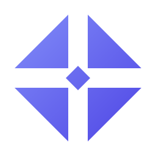

# Crux brand



## Name

- Product name: **Crux**. Always written with a capital C and lowercase rest. Never "CRUX" or "crux" in running text.
- Crux is Latin for "cross" and also means "the core of something".
- Use "Crux Crosshair" only where the name alone is ambiguous, for example in repository names, store listings or search keywords.
- Debug builds are called "Crux Dev".
- The app was called ND Crosshair up to version 1.2. Mention the old name only where it helps users find their way, for example in the migration notes.

## Tagline

- English: "Crosshair overlay for Windows"
- German: "Fadenkreuz-Overlay für Windows"

## Identifiers

| Where | Value |
|---|---|
| Code namespaces and projects | `Crux.App`, `Crux.Core`, `Crux.Core.Tests` |
| Executable | `Crux.exe` |
| AppData folder, autostart value, mutex, Velopack pack id | `CruxCrosshair` (debug: `CruxCrosshair.Dev`) |
| Repository | `nowaaak/crux-crosshair` |
| Share codes | `CRX3-` (classic), `CRX4-` (layers). `NDX1-` to `NDX4-` are read for compatibility. |

## Logo

A diamond split by a cross-shaped gap into four triangular facets, with a small diamond core in the center. The crosshair is the negative space.

- Source of truth: `LogoGeometry` in `src/Crux.App/Theme.xaml`, drawn on a 64 by 64 grid.
- The emblem stands on its own without a tile or background, so it works on light and dark taskbars.
- Keep the gap between the facets at 8 units on the 64 grid. Narrower gaps close up at 16 px.
- Do not rotate the emblem, add outlines or use colors other than the ones below.

## Colors

| Use | Color |
|---|---|
| Logo gradient (release) | `#818CF8` top left to `#4F46E5` bottom right (indigo, matches the app accent) |
| Logo gradient (debug) | `#4ADE80` top left to `#15803D` bottom right |
| App accent | `#666AF9` (dark), `#4F46E5` (light). See the design system below. |

## Design system

The settings window follows the same design language as Orrery (`custom_launcher`), which is built on shadcn/ui with the neutral base color and an indigo primary. Crux translates those tokens to WPF.

- Palettes: `src/Crux.App/Themes/Palette.Dark.xaml` and `Palette.Light.xaml`. Both define the same keys. `ThemeService` swaps them at runtime, so every color in XAML must be referenced with `DynamicResource`.
- Styles: `src/Crux.App/Theme.xaml`. Styles, converters, icons and the logo are referenced with `StaticResource`.
- The crosshair overlay and the preview scenes are not themed. A crosshair has to look the same as in the game.

### Tokens

Values are the Orrery oklch tokens converted to sRGB.

| Token | Orrery name | Dark | Light |
|---|---|---|---|
| `WindowBrush` | background | `#151515` | `#FAFAFA` |
| `SidebarBrush` | sidebar | `#0F0F0F` | `#F3F3F3` |
| `CardBrush` | card | `#1C1C1C` | `#FFFFFF` |
| `PopupBrush` | popover | `#1E1E1E` | `#FFFFFF` |
| `MutedBrush` | muted | `#242424` | `#F0F0F0` |
| `HighlightBrush` | accent | `#262626` | `#EBEBEB` |
| `SidebarAccentBrush` | sidebar-accent | `#222222` | `#E3E3E3` |
| `TextBrush` | foreground | `#F5F5F5` | `#161616` |
| `TextSecondaryBrush` | muted-foreground | `#989898` | `#5D5D5D` |
| `AccentBrush` | primary | `#666AF9` | `#4F46E5` |
| `RingBorderBrush` | ring | `#8792FF` | `#686FE9` |
| `DangerBrush` | destructive | `#FF6467` | `#E7000B` |
| `CardBorderBrush` | ring-foreground/10 | white 10 % | `#161616` 10 % |

### Shape and type

- Radius scale from a 10 px base: 6 (small), 8 (buttons, inputs, nav items), 10 (popups, segment hosts), 14 (cards), 18 (content panel corner).
- Font: Geist (Regular, Medium, SemiBold, Bold), embedded in the app. Body text is 14 px, page titles 24 px SemiBold.
- Controls are 32 px high. Nav items are 36 px high.
- Icons are Lucide, drawn on a 24 grid with a stroke of 2 and round caps, shown at 16 px by default (`IconElement`).
- Shell: title bar across the full width with the logo and product name on the left and the current page in the center. The sidebar shares the darker surface with the title bar. Content sits on a raised panel with a rounded top left corner.

## Regenerating the icons

Run this from the repository root after changing `LogoGeometry`:

```powershell
dotnet run tools/IconGen.cs
```

It writes `src/Crux.App/Assets/app.ico`, `src/Crux.App/Assets/app-dev.ico` (16 to 256 px) and `docs/logo.png` (256 px).
